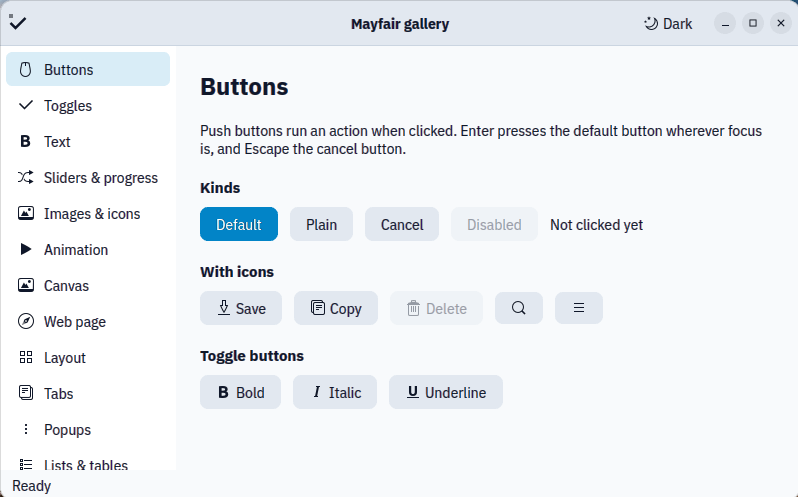

# Mayfair

Mayfair is a desktop UI toolkit for the D programming language. It features retained-mode widgets laid out in a tree, styled with CSS, optionally described in XML, and drawn on the GPU with vector graphics.



> **Mayfair is at v0.1.** It's usable, and I am building personal and toy apps with it, but the API is still heavily in development and will have breaking changes. Mayfair is not ready for anything more than simple prototyping and playing with, and definitely not ready for production.
>
> It's also a side project, so updates may be slow and irregular, and it could be dropped
> altogether.

```d
import mayfair;

void main()
{
    auto app = new App("Hello");
    auto greeting = new Label("Hello, world");

    auto column = new Column;
    column.setSpacing(12);
    column.setAlignment(Pos.centre);
    column.add(greeting);
    column.add(new Button("Say hello").onAction({ greeting.setText("Hello from Mayfair"); }));

    app.scene = new Scene(column);
    app.run();
}
```

The same window can be written as a view, with its layout in XML and its behaviour in a class:

```xml
<!-- resources/views/main.xml -->
<Column spacing="12" alignment="centre">
    <Label id="greeting" text="Hello, world"/>
    <Button text="Say hello" onAction="sayHello"/>
</Column>
```

```d
import mayfair;

@View("main.xml")
class Main
{
    @xml Label greeting;

    private void sayHello() { greeting.setText("Hello from Mayfair"); }
}

void main()
{
    auto app = new App("Hello");
    app.scene = new Scene(View.load(new Main));
    app.run();
}
```

The XML is read and compiled into a widget tree at compile time, so a mistake in a view (a misspelt widget, a handler that
doesn't exist) is a compile error, not a crash.

## What's in it

Mayfair builds on other people's libraries for drawing, layout and text (see [Thanks](#thanks)),
and adds the toolkit around them.

- **Widgets:** buttons, check boxes, toggles, text fields and areas, password fields, sliders,
  progress bars, combo boxes, menus, dialogs, tabs, list, tree and table views (virtualised, so
  they scale to large data), a navigation sidebar, a scroll pane, a split pane, a canvas, images, icons, Lottie
  animations, and LiteWebView for simple HTML.
- **GPU views:** `GpuView` is drawn by the app itself, with WebGPU: a 3D view, a CAD model, a
  game. It draws into a texture on the window's own GPU, which goes in the window in its place
  among the other widgets, under what's laid over it, without being copied.
- **Layout:** rows, columns, grids, docks and flexbox (Yoga).
- **Styling:** CSS, with variables. The default theme follows the desktop's light or dark mode,
  its icon theme, where it puts the title-bar buttons, and how it smooths text.
- **Properties:** observable properties that can be listened to, mapped and bound to each other.
- **Text:** full Unicode: shaping (HarfBuzz), bidirectional text, line breaking, and
  selectable, copyable labels.
- **Text editing:** `TextView` and `TextBuffer`, as GTK has them. It scales to files of
  hundreds of thousands of lines.
  - Undo and redo.
  - Marks, and tags for colouring and underlining ranges.
  - A gutter of line numbers.
  - Auto-indentation and bracket matching.
  - Find and replace.
  - Moving and commenting out lines.
  - Input methods.
- **Translation:** an app's strings in `strings.xml`, one entry per language.
- **Drag and drop:** files and text dragged in from other apps, dropped on any widget, handled
  as in JavaFX: `onDragOver` accepts a drag, and `onDragDropped` is given what was dropped.
- **Accessibility:** screen readers are told about every widget, through AccessKit.
- **Notifications:** desktop notifications, with buttons, through the freedesktop.org
  notification service (or the desktop portal, in a Flatpak) on Linux and the BSDs.
- **Rendering:** ThorVG on WebGPU (Vulkan or Metal underneath), falling back to OpenGL and then
  to the CPU where the GPU can't.
- **Themes:** Mayfair's own, and the Oriel desktop's (`mayfair.theme.oriel`): its palette, its
  traffic lights, and frosted-glass sidebars that run up behind the app's own title bar, which
  follows the sidebar as it's resized, hidden and shown (`TitleBar.sidebar`).
- **Wayland first:** client-side decorations, fractional scaling, and frame pacing to the
  compositor.

In packages of their own:

- **Video and audio:** [`mayfair-media`](mayfair-media) has `Media`, `MediaPlayer` and
  `MediaView`, as JavaFX has them, with the controls left to the app to build from Mayfair's
  widgets. [`mayfair-gstreamer`](mayfair-gstreamer) plays them with the system's GStreamer, which
  is LGPL: see its README for what it needs and its licences.
- **PDFs:** [`mayfair-pdf`](mayfair-pdf) has `PdfDocument`, and `PdfView` to read one in: zoom,
  search, selecting and copying text, links, and a sidebar of thumbnails and contents. Documents
  can be edited and saved: pages rotated, moved, deleted, inserted and cropped; annotations made
  with the view's markup tools; forms filled in; every change undoable. They're read with PDFium
  (BSD), which the package downloads prebuilt as it's built and puts beside the app: one
  dependency, nothing to set up.
- **Code editing:** [`mayfair-code`](mayfair-code) highlights a `TextView` in 25 languages, LaTeX
  among them, as it's edited. It connects the view to language servers (pyright, clangd, rust-analyzer, gopls,
  serve-d, texlab and others), which give errors underlined as you type, completions, hovers, and going
  to a definition. It has no libraries: the servers are separate programs, found on `PATH`.
- **A terminal:** [`mayfair-terminal`](mayfair-terminal), on alacritty_terminal.

## Platforms

| Platform | |
|---|---|
| Linux (Wayland and X11) | The main target: developed and tested on (Ubuntu 26.04, GNOME) |
| FreeBSD | A primary intended target, but untested for now |
| macOS and Windows | Not supported, as I can't test on them |

I won't be supporting macOS or Windows directly, but I'm happy to take fixes that get Mayfair
running there. Some parts only work on Linux and the BSDs for now: screen readers are spoken to
through AT-SPI, and the file chooser is the desktop portal's.

An experimental browser build (WebAssembly, through Emscripten) is in [`mayfair/web`](mayfair/web):
[`hello-web`](examples/hello-web) runs in it. It draws on the CPU, and has no LiteWebView,
accessibility, file dialogs, notifications or drag and drop.

What it builds is a folder of static files to serve: `index.html`, `index.js` and `index.wasm`.
The app fills its page, so an `<iframe>` of that page puts it in another site's page, at the
iframe's size. That's a live example in documentation, say:

```html
<iframe src="/examples/hello/index.html" width="760" height="420" loading="lazy"></iframe>
```

- **Size:** each example is about 2.8 MB of WebAssembly gzipped (7.8 MB as it is), so serve it
  compressed. `loading="lazy"` keeps a page of several from fetching those out of sight.
- **Serving:** the files want the `application/wasm` type, which Rack, nginx and most servers
  give `.wasm` already.
- **Browsers:** Chrome 137 and Firefox 131 on, for WebAssembly's newer exceptions.

## Building

Mayfair currently needs LDC 1.41 or later, dub, SDL3, CMake, Meson and a C/C++ compiler; Rust's
cargo too, for `mayfair-terminal`, and for Mayfair itself anywhere but Linux x86_64. DMD 2.111 or
later may work instead of LDC, but is untested, and its code is slower, as its optimiser isn't as
good. GDC can't build Mayfair: its ImportC doesn't run the C preprocessor, so it can't read the
headers the C bindings include. On Ubuntu 26.04 or FreeBSD 14, `setup.sh` installs all of it
and builds the gallery:

```sh
git clone --recurse-submodules https://github.com/fhornsby/MayfairUI.git
cd MayfairUI
./setup.sh
cd examples/gallery && dub run
```

To use Mayfair in an app, depend on it by path in the app's `dub.json`:

```json
"dependencies": {
    "mayfair": { "path": "../MayfairUI/mayfair" }
}
```

The first build compiles its C and C++ dependencies (`mayfair/vendor/build.sh`), which takes a
few minutes; after that they're only rebuilt when they change.

### Prebuilt native libraries

Each released version of Mayfair (a `v` tag, such as `v0.2.0`) has its native libraries prebuilt
by CI and attached to its GitHub release, for Linux on x86-64 and ARM64 so far. When dub builds a
released version, it downloads the archive for its platform instead of building them, checks it
against the release's `SHA256SUMS`, and unpacks it; then only LDC, dub and SDL3 are needed. A git
checkout, like the one above, builds them from source as before, and so does a release whose
download fails. To choose for yourself:

| | |
|---|---|
| `MAYFAIR_NATIVE=build` | build them from source, whatever the version |
| `MAYFAIR_NATIVE=path/to/archive.zip` | unpack an archive you've downloaded already, offline say |
| `MAYFAIR_NATIVE_URL=https://...` | download from a mirror of the releases |

## Examples

| | |
|---|---|
| [`gallery`](examples/gallery) | Every widget, a page each |
| [`hello-xml`](examples/hello-xml) | Hello world, its window written in XML, with widgets of its own |
| [`hello-web`](examples/hello-web) | The same, in a browser |
| [`markdown-editor`](examples/markdown-editor) | A Markdown editor: a folder's files, a tab per document, and a live preview |
| [`latex-editor`](examples/latex-editor) | OverBrief, a LaTeX editor in the manner of Overleaf: a project's files, the source and the PDF side by side, compiled with latexmk, SyncTeX both ways. Laid out in XML, a view and a module for each part |
| [`code-editor`](examples/code-editor) | A code editor in the Oriel theme: a folder's files, a tab per file, highlighting, and language servers for errors, completions and definitions |
| [`pdf-viewer`](examples/pdf-viewer) | A PDF viewer and editor, modelled on macOS's Preview, in the Oriel theme: markup, signatures, forms, page editing, export and printing |
| [`gpu-cube`](examples/gpu-cube) | A `GpuView`: a lit cube drawn with WebGPU, spinning, and turned by dragging it |
| [`appwrite-todo`](examples/appwrite-todo) | A to-do list stored in Appwrite, with sign-in |
| [`oriel-hello`](examples/oriel-hello) | An app for the Oriel desktop environment (currently unreleased), with a frosted-glass sidebar |

## To do

What's still to be done, that I know of:

**Text**
- Plurals in `strings.xml`, so "1 file" and "3 files" can each be translated. Most languages
  don't count the way English does: French treats 0 as singular, Russian and Polish have three or
  four forms, and Arabic has six.
- Read the display's subpixel layout (RGB, BGR or vertical) from Wayland's `wl_output`, rather
  than assuming RGB.
- At 14px, lowercase letters come out a pixel taller than Zed's, as the hinting rounds their
  height up.
- Choose a default font. IBM Plex Sans is bundled for now, so Mayfair can be compared side by
  side with Zed.
- Justified text: `TextAlignment.justify` lines text up on the left for now.

**Text editing**
- Line wrapping in `TextView`. Lines scroll sideways for now, which the LaTeX editor feels most:
  its paragraphs are long lines.
- More than one caret, and column selections.
- Right-to-left and mixed-direction lines in `TextView`. They're shaped, but the caret and
  selection only approximate where they should be.
- Screen readers: a `TextView` gives them its text, but not yet line by line, as large texts need.
- Tree-sitter grammars, for highlighting that knows the language's grammar.
- More of the Language Server Protocol: renaming, formatting, quick fixes, signature help, and
  finding references.
- Typing into popups on X11 without a window manager (Xvfb), where they don't get the keyboard.
  Dialogs are used for now.

**GPU views**
- Drawing on a thread of its own, so a heavy scene doesn't hold up the rest of the window.
- In the browser, with its WebGPU, and on the OpenGL renderer without a copy through the CPU:
  there, for now, what's drawn is read back and shown as an image.
- Getting the device back after it's lost (a driver reset, say).

**Video and audio**
- Show frames from a GPU texture shared with the backend, rather than copying each one into an
  image.
- An FFmpeg backend, `mayfair-ffmpeg`, with SDL3 playing the sound.
- Gapless looping, for short clips, with GStreamer's segment seeks.
- Choosing audio and subtitle tracks, the playback rate, and subtitles drawn by Mayfair.
- Loading ahead for a feed: players for the items just off screen, ready before they're scrolled to.
- Test network streams and their buffering, other formats, and macOS and Windows.

**PDFs**
- Redacting, and text boxes edited on the page, in fonts with more than Latin-1.
- Search options: matching case and whole words.
- Printing on Windows, and a print preview.
- Images on Mayfair's clipboard, to copy a region of a page as a picture.
- Uploading tiles straight to the GPU, rather than through an image.
- Test on macOS, Windows and ARM64, and with PDFs and annotations from more producers.

**Drag and drop**
- Dragging out of an app, to another app or the desktop, and from one widget to another within
  it. Only dropping in from outside works so far.
- Knowing what's dragged before it's dropped, so a widget can refuse it while it's dragged over:
  SDL only gives the files or text once they're dropped, and can't tell the app it came from
  whether the drop was taken.

**Desktop**
- A settings source for to replace GSettings, reducing dependency on GNOME.

**Platforms**
- Test on FreeBSD, a primary target that's untested so far.
- Give the browser build more than the CPU renderer, and build it in CI, so it can't break
  unnoticed again.
- Notifications on macOS and Windows, which have none yet.

**Building**
- Try building with DMD, which is allowed but untested, and with D front ends older than 2.111
  (LDC 1.41's), to find what really works. 2.106 (LDC 1.36) can't: its ImportC has no
  `#pragma attribute`.

**Before 1.0**
- Audit the code by hand, once a few apps have been built with it (see below).

## Licence

Mayfair is under the [MIT licence](LICENSE), and everything it depends on is under a permissive
licence too: nothing is copyleft, so an app built with it can be statically linked and closed
source.

Static linking does mean an app built with Mayfair has to ship its dependencies' notices:
[`mayfair/THIRD_PARTY_NOTICES.md`](mayfair/THIRD_PARTY_NOTICES.md) has all of them, and
[`mayfair-terminal/THIRD_PARTY_NOTICES.md`](mayfair-terminal/THIRD_PARTY_NOTICES.md) has the
terminal's.

## Thanks

Mayfair stands on a lot of other people's work.

**The libraries it's built on:** [ThorVG](https://www.thorvg.org) draws everything,
[wgpu](https://wgpu.rs) puts it on the GPU, [Yoga](https://yogalayout.dev) lays it out,
[FreeType](https://freetype.org) and [HarfBuzz](https://harfbuzz.github.io) set its text,
[SheenBidi](https://github.com/Tehreer/SheenBidi) and
[libunibreak](https://github.com/adah1972/libunibreak) handle right-to-left text and line breaks,
[litehtml](https://github.com/litehtml/litehtml) lays out HTML, [AccessKit](https://accesskit.dev)
speaks to screen readers, [SDL](https://libsdl.org) opens the windows,
[alacritty_terminal](https://github.com/alacritty/alacritty) runs the terminal, and
[IBM Plex](https://www.ibm.com/plex/) and [DejaVu](https://dejavu-fonts.github.io) are its current default fonts.
And [D](https://dlang.org) and [LDC](https://github.com/ldc-developers/ldc), which it's written in.

**The toolkits it learnt from:** [JavaFX](https://openjfx.io) above all: the scene and its tree
of widgets, styling with CSS, views written in markup, and observable properties are all its
ideas, respelt. [GNOME](https://www.gnome.org) and GTK, for how a Linux app should look and
behave: the default theme, overlay scroll bars, client-side decorations and the icon theme follow
them. [Flutter](https://flutter.dev), for how layout and painting are split. And
[Spring](https://spring.io), for `@autowired`.

## About its development

Mayfair is written with the help of AI (Claude, by Anthropic), and the commits it helped with
say so. Further breaking changes are expected. Once a few apps have been made (to a reasonable production standard), and any bugs or oddities have been worked out, I intend to audit the code by hand. From then on, changes made with AI help are kept small and reviewed one at a time.
